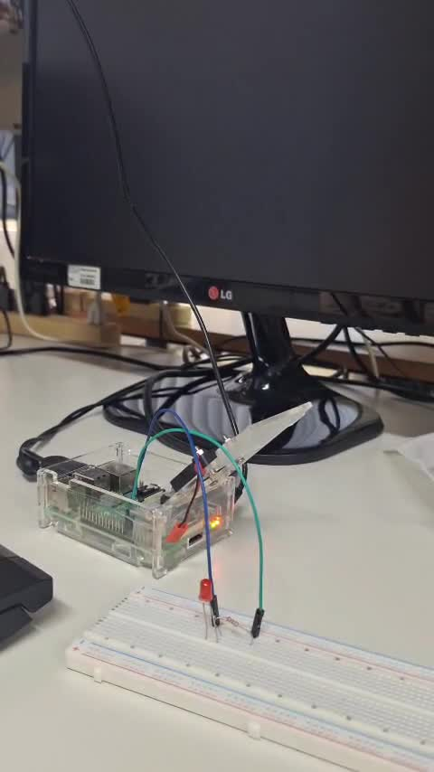
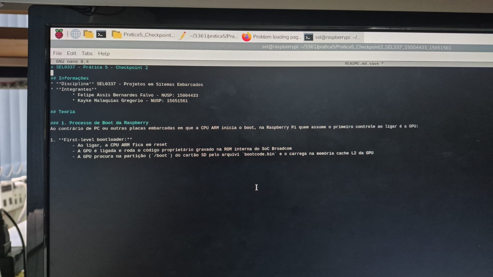

# SEL0337 – Prática 5 – Checkpoint 2

**Disciplina:** SEL0337 – Projetos em Sistemas Embarcados  

### Integrantes
- Felipe Assis Bernardes Falvo — Nº USP: 15004433
- Kayke Malaquias Gregorio — Nº USP: 15651561

---

## 1. Resumo e Objetivos

Essa prática tem como objetivo a personalização do processo de inicialização (*boot*) em sistemas Linux utilizando o gerenciador de serviços **SystemD**, junto com a documentação e controle de versão de código com **Git** e **GitHub**.

O objetivo é criar um serviço para a execução de uma aplicação em Python para controle de hardware (GPIO 18), permitindo que a aplicação inicie durante o boot da placa e seja encerrada com a liberação dos recursos da GPIO ao parar o serviço.

---

## 2. Fundamentação Teórica

### 2.1. Processo de Boot da Raspberry Pi 3B+ (SoC Broadcom BCM2837B0)

Ao contrário de PC, na Raspberry Pi quem assume o primeiro controle ao ligar é a **GPU VideoCore IV**:

1. **First-level bootloader:**
   - Ao alimentar, a CPU ARM fica desativada
   - A GPU é energizada e executa o código gravado na ROM interna do SoC Broadcom BCM2837B0
   - A GPU busca na primeira partição FAT32 (`/boot`) do cartão microSD o arquivo `bootcode.bin` e carrega ele na memória cache L2 da GPU.

2. **Second-level bootloader:**
   - O `bootcode.bin` executa na GPU, habilita os barramentos da memória SDRAM LPDDR2 (1 GB) e carrega o firmware `start.elf`.

3. **Third-level bootloader:**
   - O firmware `start.elf` le as configurações de hardware no `config.txt` e os arquivos de mapeamento de periféricos (`.dtb`).
   - Carrega a imagem do Kernel Linux (`kernel.img` / `kernel7.img`) para a memoria SDRAM.
   - Passa as informações em `cmdline.txt` e transfere a execução para os núcleos da CPU ARM Cortex-A53.

4. **Init System e Rootfs:**
   - A CPU ARM assume a execução, monta o sistema de arquivos root (`rootfs`, partição ext4) e chama o primeiro processo do espaço de usuário), que é o SystemD.

### 2.2. Init System: SystemD vs. SysVinit

O Init System é a parte que é responsável pelo gerenciamento de serviços e processos da distribuição Linux desde o carregamento do Kernel até o desligamento dele.

- **Inicialização:**
  - **SysVinit (Antigo):** Sequencial (executa um processo por vez através de scripts Bash)
  - **SystemD (Novo):** Paralelizado (serviços iniciam simultaneamente)

- **Arquivos de Serviço:**
  - **SysVinit (Antigo):** Scripts Shell armazenados em `/etc/init.d/`.
  - **SystemD (Novo):** Arquivos `.service` (unit files) que ficam em `/lib/systemd/system/`

- **Gerenciamento de Processos:**
  - **SysVinit (Antigo):** Dificuldade em encontrar e controle de processo
  - **SystemD (Novo):** Divisão por meio de `cgroups` (Control Groups)

- **Utilitário de Controle:**
  - **SysVinit (Antigo):** Comando `service`
  - **SystemD (Novo):** Comando `systemctl`

---

## 3. Estrutura dos arquivos

O repositório tem todos os códigos da aplicação Python, o arquivo de unidade do SystemD e a documentação do projeto:

- **`blink_service.py`**: Código em Python responsável por piscar o LED conectado à GPIO 18 em intervalos de 0,2 s (chamado em `ExecStart`).
- **`parar_blink.py`**: Código que é executado para parar o serviço (`ExecStop`), permitindo que a GPIO 18 fique em nível baixo (`LOW`) e limpa via `GPIO.cleanup()`.
- **`blink_check1.service`**: Unit file do SystemD configurado para inicializar e gerenciar o serviço no linux.
- **`README.md`**: Relatório com a fundamentação e instrução
- **`historico_git.txt`**: Log do histórico de commits

---

## 4. Códigos do Projeto

### 4.1. Código Principal: `blink_service.py`

```python
#!/usr/bin/env python3

import RPi.GPIO as GPIO
import time

GPIO.setmode(GPIO.BCM)

led = 18  # pino do LED
GPIO.setup(led, GPIO.OUT)

try:
    while True:
        GPIO.output(led, GPIO.HIGH)
        time.sleep(0.2)
        GPIO.output(led, GPIO.LOW)
        time.sleep(0.2)
except KeyboardInterrupt:
    GPIO.cleanup()
```

### 4.2. Código para Parar: `parar_blink.py`

```python
#!/usr/bin/env python3

import RPi.GPIO as GPIO

GPIO.setmode(GPIO.BCM)

led = 18

GPIO.setup(led, GPIO.OUT)
GPIO.output(led, GPIO.LOW)
GPIO.cleanup()
```

### 4.3. Arquivo de Unidade do SystemD: `blink_check1.service`

```ini
[Unit]
Description= Blink LED (Python)
After=multi-user.target

[Service]
ExecStart=/usr/bin/python3 /home/sel/3361/pratica5/blink_service.py
ExecStop=/usr/bin/python3 /home/sel/3361/pratica5/parar_blink.py
User=sel

[Install]
WantedBy=multi-user.target
```

#### Tópicos do Unit File

- **`[Unit]`**: `Description` indica a mensagem apresentada no log do SystemD. `After=multi-user.target` permite que o serviço inicie depois que o sistema ficar em nível multiusuário.
- **`[Service]`**: `ExecStart` indica o caminho do interpretador Python e do código a ser executado. `ExecStop` indica o comando usado ao parar o serviço (`sudo systemctl stop blink_check1.service`). `User=sel` define que a execução ocorre no usuário `sel`.
- **`[Install]`**: `WantedBy=multi-user.target` junto a inicialização do serviço com o boot do sistema (`systemctl enable`).

---

## 5. Procedimento experimental e comandos

### 5.1. Circuito

Conexão de um LED com resistor ao pino correspondente à GPIO 18 e GND na protoboard.



### 5.2. Criação dos códigos em python

```bash
python3 blink_service.py
```

### 5.3. Instalação da unidade de serviço no SystemD

```bash
sudo cp blink_check1.service /lib/systemd/system/
sudo systemctl daemon-reload
```

### 5.4. Testes do serviço com `systemctl`

```bash
#inicia o serviço manualmente
sudo systemctl start blink_check1.service

#verificando o status da execução
systemctl status blink_check1.service

#parar o serviço (liga o ExecStop => parar_blink.py)
sudo systemctl stop blink_check1.service
```

### 5.5. Inicialização automática no boot

```bash
sudo systemctl enable blink_check1.service
sudo reboot
```

### 5.6 Readme



---

## 6. Resultados e Validação

- O serviço foi iniciado automaticamente durante o boot da raspberry, deixando o LED piscando.
- Execução dos comandos `systemctl start` e `systemctl stop` permitiu verificar a mudança entre o `blink_service.py` e o `parar_blink.py`, deixando a GPIO liberada e o LED apagado quando parava.
